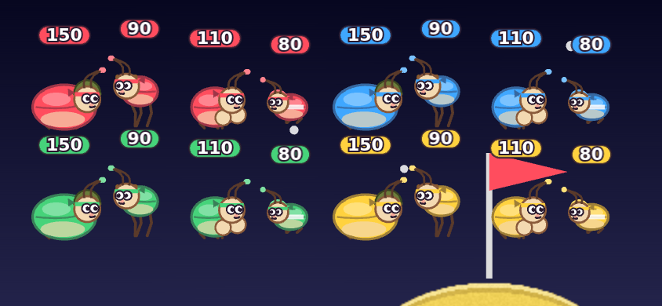

# War Roaches

Hot-seat artillery chaos for 2–4 players on one phone or tablet. Cute cartoon roaches, five absurd destructible maps, silly weapons. Installable PWA that works offline and offers updates when back online.



## How to play
- Pick a map, the number of players (2–4) and the turn time (30/45/60 s). Pass the phone when the card says so.
- **Move:** ◀ ▶ to walk, ⤴ to jump, hold ⤴ in the air to glide (no fall damage).
- **Shoot:** drag back from your roach like a slingshot and let go. Drag back onto the roach to cancel.
- **Camera:** drag the map with one finger, pinch to zoom.
- **Weapons:** Bazooka, Grenade (adjustable fuse) and Slipper are unlimited; crates hold Bug Spray, Big Shoe (tap where to stomp), Disco Bomb, Gum Mine, Hot Sauce, Rubber Duck, Toothpick Rope and Pizza (+35 HP).
- **Roaches:** Chonk (tanky, Belly Slam), Stilts (huge jumps, Periscope = full aim preview), Brawler (double melee, Mega Flick), Zippy (fast, double jump, Scuttle Dash).
- Falling into the goo costs 30 HP and spits you back — roaches are hard to kill. Last team standing wins. After 12 minutes the goo starts rising.

## Develop
```sh
nix develop --no-pure-eval   # or: direnv allow
npm install
npm run dev                  # open the LAN URL on your phone
npm test
```
Dev-only visual sandbox: `/war-roaches/?dev=map&map=cake&zoom=0.8` (tap to explode), `&strip=1` shows all roach styles.

## Build
```sh
nix build                    # static site in ./result
```
When `package-lock.json` changes, set `npmDepsHash = nixpkgs.lib.fakeHash;` in `flake.nix`, run `nix build`, and paste the `got:` hash.

## Deploy
GitHub Pages via `.github/workflows/deploy.yml`: runs on push to `master` and manually (Actions → Deploy to GitHub Pages → Run workflow).
One-time: repo Settings → Pages → Source: **GitHub Actions**. The site is served at `/war-roaches/` (rename `base` in `vite.config.ts` if the repo name differs).
